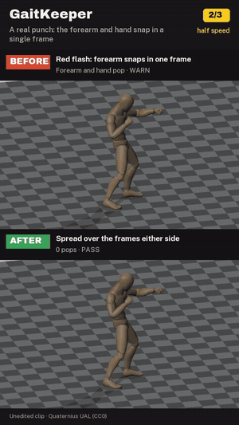

# GaitKeeper

A free Blender add-on that checks your animation clips for the faults players notice: feet that slide or sink, knees that bend the wrong way, loops that hitch, one-frame pops. Each clip gets PASS, WARN or FAIL with a plain-English reason.


*A clean walk with faults added on purpose (top), and the same clip after Fix (bottom). Test clip: Quaternius Universal Animation Library, CC0.*

## What it checks

It works on people (two legs, two arms, any common bone naming) and on animals (four legs, or a hopper with a tail).

| Check | What it means |
| --- | --- |
| Skating | A foot that should be planted slides along the floor. |
| Sinking and floating | A planted foot goes through the floor, or hovers above it. |
| Backward and sideways joints | A knee or elbow bends past what a body can do, or off its hinge. |
| Pops | A bone snaps to a new angle in one frame instead of turning over a few. |
| Loop seam | The last frame of a loop doesn't meet the first, so it hitches every cycle. |
| Balance | The body's weight sits outside the feet while it stands still. |
| Runs that never leave the ground | A run or sprint with no moment where both feet are off the floor. |
| Walk speed and cadence | Steps per minute far outside what a walk looks like. |
| Attacks with no wind-up | A punch, kick or bite that starts at full speed with no coil, or stops dead at the hit. |
| Enemy tells | With "Attacks are for: Enemies", every attack must give the player about 300 ms to react. |
| Animal legs | Legs that bow out sideways, feet set too wide in the rest pose, hops that hang wrong. |
| Skin | Mesh that collapses or stretches badly when a joint bends (people, when a skinned mesh is found). |

Checking changes nothing in your scene. The clip and frame you were on are put back afterwards.

## Install

1. Download `gaitkeeper-0.9.0.zip` from the [Releases](../../releases) page.
2. In Blender 4.2 or newer: **Edit > Preferences > Get Extensions**, open the arrow menu at the top right, choose **Install from Disk**, and pick the zip. (Dragging the zip onto Blender works too.)

## A first check, in about a minute

1. Select an armature that has some clips (actions) on it.
2. In the 3D View press **N** to open the sidebar and click the **GaitKeeper** tab.
3. Press **Check clips**.

The panel lists every clip, worst first. Click a clip's name to play it. The full report goes to the Text Editor as "GaitKeeper report". Here is part of one for the free Quaternius UAL 2 pack:

```text
GaitKeeper: Armature (checked as: person)
42 clips: 16 pass, 26 warn, 0 fail

WARN  Farm_PlantSeed
      - r foot slides 0.25 m/s while planted (skating).
      - off balance: the body's weight sits 20 cm outside the feet while it stands, so it would tip over. Move the hips back over the feet.
WARN  Hit_Knockback
      - sudden jumps between two frames (pops) in: thigh_l (frame 5). A bone snaps to a new angle instead of turning over a few frames; smooth the keys there.
```

Treat a WARN as a place to look. Some are deliberate: a knockback is meant to be violent. FAIL is kept for things a body can't do.

## Fixing a clip

**Fix current clip** makes a copy called `<clip>_fixed` and leaves the original alone. On people it re-plants sliding feet (moving them 8 cm at most), closes the loop seam, smooths pops, and can move the body's travel onto the root bone or remove it ("Walk on the spot"). On animals it brings legs that bow out sideways back into line. The copy is checked again, and if the fix made anything worse it is thrown away.




## Pose Adapt

Pose some bones on one frame (without keying them) and press **Adapt clip to this pose**. The change is baked into a copy, spread over the whole clip, over the same moment of every step (mirrored on the other foot), or only around that frame. Feet you didn't touch stay planted. To change several frames, pose one and press **Keep this pose**, then the next, then Adapt.

## Settings

| Setting | What it does |
| --- | --- |
| Body | Auto tells people from animals by the skeleton. Set it by hand if it guesses wrong. |
| Hopper | For two-legged animals with a tail, such as a kangaroo. |
| Every clip is a leg strike | Judge every clip as a kick, whatever its name. |
| Attacks are for | Player attacks can be as fast as you like; enemy attacks must be readable. |
| Current clip only | Check just the clip that is playing. |
| Root motion | What Fix does with the body's travel. |

## Rigs it has been run on

- Quaternius Universal Animation Library 1 and 2 (CC0), every clip.
- Commercial game packs: a Border Collie (four legs), a kangaroo (hopper), humanoid packs with a constant root bone above the hips, and Unity's Starter Assets character.
- Small rigs built in code for the tests.

Clip names matter. GaitKeeper reads words like `walk`, `run`, `loop`, `punch` and `kick` in a clip's name to decide which checks apply, so `Run_Loop` is judged as a looping run and `Attack_02` as an attack.

## Known limits

- It finds bones by name (Mixamo-style, Unreal-style, `.L`/`.R` and similar). An unusual naming scheme may need the Body setting set by hand, and a rig with a bone named "tail" is treated as an animal on Auto.
- Check clips takes every action in the file that keys this armature's bones. Two characters with the same bone names in one file will pick up each other's clips; tick **Current clip only** there.
- Feet are judged against a flat floor. A clip authored on a slope or on stairs will read as sinking or floating.
- Each clip is played frame by frame through Blender, so a heavy scene with high-poly meshes is slow to check.
- The thresholds come from motion-capture data and real footage of people, dogs and kangaroos. They suit realistic and semi-realistic motion. Cartoon timing and squash will get more WARNs, because exaggerated motion breaks the same rules a broken clip does.
- Fix handles feet, seams, pops and root motion. It won't repair a bad pose or bad timing; it tells you where they are.

## Building and testing

You need Python 3.11+ and, for the build and the smoke test, Blender 4.2+ (set `BLENDER` to its executable if it isn't on your PATH).

```sh
python -m pip install ruff pytest
ruff check . && ruff format --check .
pytest                          # the maths runs without Blender; the smoke test skips if Blender isn't found
python scripts/build.py         # builds and validates dist/gaitkeeper-<version>.zip
```

The smoke test builds the zip, installs it into a temporary Blender profile (yours isn't touched), builds a small rig in code, runs Check and Fix, and reads the report back.

## Layout

```text
gaitkeeper/            the extension (what goes in the zip)
  __init__.py          registration
  props.py             panel settings (scene.gaitkeeper)
  operators.py         Check, Fix, Show clip
  adapt_ops.py         Pose Adapt
  panel.py             the sidebar tab
  runner.py            picks person or animal, runs the checks, restores the scene
  core/                the checks; the maths modules run without Blender
tests/                 pytest, plus tests/blender/ for the headless smoke test
scripts/build.py       extension build and validation
```

## Contributing

Bug reports are most useful with the rig: a .blend (or a link to a free model) and the name of the clip that reads wrong. If a check is wrong on a clip that looks fine, say what you expected to see.

Pull requests are welcome. Keep `ruff check`, `ruff format --check` and `pytest` passing, add a test for any change to the maths, and keep the messages in plain English: `tests/test_messages.py` checks them.

## Licence

GPL-3.0-or-later, like Blender. See [LICENSE](LICENSE).

The demo clips use the Quaternius Universal Animation Library, which is CC0. No model or animation files are included in this repository.
